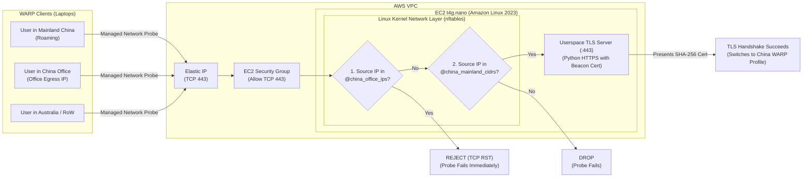

# Cloudflare One Managed Network TLS Beacon for Mainland China Roaming

A ultra-low-cost (~$3.80/month) AWS Terraform solution that deploys a **Layer-3/4 Geo-Filtered TLS Beacon** on an EC2 `t4g.nano` instance. It enables **Cloudflare One (WARP)** clients to automatically detect when a user is roaming in **Mainland China** (while excluding corporate China office egress IPs) and dynamically switch WARP Device Profiles.

---

## Problem Statement

Organizations using **Cloudflare One (WARP)** typically configure their default Device Profile with **Split Tunnels** that exclude latency-sensitive real-time media—such as **Google Meet**—so traffic routes directly from the user's laptop to Google's servers for optimal call quality.

However, when employees travel to **Mainland China**:
1. **Google services (including Google Meet) are blocked** by the Great Firewall (GFW) when routed outside the WARP tunnel.
2. Users roaming in Mainland China need to automatically switch to a **China Roaming Device Profile** where Google Meet traffic is **included inside the WARP tunnel**.
3. Users inside a **corporate China office** (which may already have dedicated routing or its own managed network profile) should **not** match the roaming profile.

### Why Layer-7 WAF Geo-Blocking Fails for Cloudflare Managed Networks

Cloudflare WARP's **Managed Networks** detection works by probing a configured `host:port` over TCP, completing a **TLS handshake**, and verifying that the server certificate matches a configured **SHA-256 thumbprint**.

- **The Caveat:** WARP Managed Network detection **only evaluates the TLS handshake and certificate thumbprint**—it ignores the HTTP response status code.
- If you place a Layer-7 WAF or serverless edge function (e.g., Cloudflare Workers or AWS WAF) in front of the beacon that completes the TLS handshake and returns `HTTP 403 Forbidden` to non-China IPs, **every WARP client worldwide still sees a valid TLS certificate and falsely triggers the China Managed Network**.
- Conversely, native AWS VPC Security Groups and NACLs cannot filter by geolocation, and **AWS Network Firewall** costs **~$285+/month** per endpoint—far too expensive for a lightweight beacon.

---

## Architectural Design

To prevent non-China clients (and China office clients) from completing the TLS handshake without paying for AWS Network Firewall, this architecture performs **stateful Layer-3/4 Geo-IP filtering directly in the Linux kernel (`nftables`)** on a single `t4g.nano` EC2 instance.

Because the EC2 instance receives packets directly on its public Elastic IP without intermediate NAT or proxies, the Linux kernel inspects the true client source IP in the `prerouting`/`input` hook **before the TCP 3-way handshake or TLS handshake ever reaches userspace**.



### How Packet Evaluation Works

1. **Rule 1 — Exclude China Office IPs (`@china_office_ips`)**:
   - Any packet to `TCP 443` matching your configured `china_office_cidrs` is immediately rejected with a `TCP RST` (`reject with tcp reset`). The WARP probe fails in milliseconds without seeing the TLS certificate.
2. **Rule 2 — Allow Optional Admin Test IPs (`@allowed_test_ips`)**:
   - Any packet matching `allowed_test_cidrs` is permitted through for administrative testing outside China.
3. **Rule 3 — Allow Mainland China CIDRs (`@china_mainland_cidrs`)**:
   - An automated script (`/usr/local/bin/update-geo-firewall.sh`, run at boot and daily via `cron.daily`) fetches the aggregated Mainland China IPv4 CIDR blocks and loads them atomically into an `nftables` interval set. Matching packets are accepted and reach the userspace TLS server.
4. **Rule 4 — Default Drop on TCP 443**:
   - All other global traffic to `TCP 443` is dropped at the kernel level before the TCP `SYN` is acknowledged.
5. **Userspace HTTPS Beacon Server (`:443`)**:
   - Generates a 10-year self-signed X.509 certificate on boot, logs the **SHA-256 thumbprint** to the EC2 system console, and serves the client's public IP address as plain text (`200 OK`) alongside an `X-Cert-SHA256` response header.

---

## Cost Breakdown

| Resource | Specification | Estimated Monthly Cost (USD) |
| :--- | :--- | :--- |
| **Amazon EC2** | `t4g.nano` (2 vCPU, 0.5 GB RAM, Graviton2, On-Demand) | ~$3.80 |
| **Amazon EBS** | 8 GB `gp3` root volume | ~$0.64 |
| **Elastic IP** | 1x Static IPv4 (attached to running instance) | ~$3.65 |
| **Linux `nftables`** | Kernel L3/L4 Geo-Firewall + Daily CIDR Cron | $0.00 |
| **Total** | | **~$8.09 / month** *(vs. ~$290+/mo with AWS Network Firewall)* |

---

## Deployment Instructions

### Prerequisites
- [Terraform](https://developer.hashicorp.com/terraform/install) >= 1.5.0
- [AWS CLI v2](https://docs.aws.amazon.com/cli/latest/userguide/getting-started-install.html) configured with credentials for your target AWS account/project

### 1. Configure Variables (Optional)

Copy the example variables file and customize your region, China office egress IPs to exclude, and optional admin test IPs:

```bash
cp terraform.tfvars.example terraform.tfvars
```

Edit `terraform.tfvars`:

```hcl
aws_region         = "ap-southeast-2"
china_office_cidrs = ["203.0.113.10/32"] # Replace with your China office public IP(s)
allowed_test_cidrs = ["198.51.100.25/32"] # Optional: Your workstation IP to test with curl
```

### 2. Initialize and Apply

*(Note: If authenticating via `aws login`, export temporary session credentials first with `eval $(aws configure export-credentials --profile <profile> --format env)`).*

```bash
terraform init
terraform plan
terraform apply
```

### 3. Retrieve the TLS Certificate SHA-256 Thumbprint

Wait ~60 seconds after instance creation for `cloud-init` to complete, then run the command provided in the `get_certificate_sha256_command` Terraform output:

```bash
$(terraform output -raw get_certificate_sha256_command)
```

Example output:
```text
==================================================================
CLOUDFLARE ONE MANAGED NETWORK TLS BEACON READY
Certificate SHA-256 (Hex):    4a7f9b2c1d8e3f0a5b6c7d8e9f0a1b2c3d4e5f6a7b8c9d0e1f2a3b4c5d6e7f8a
Certificate SHA-256 (Colons): 4A:7F:9B:2C:1D:8E:3F:0A:5B:6C:7D:8E:9F:0A:1B:2C:3D:4E:5F:6A:7B:8C:9D:0E:1F:2A:3B:4C:5D:6E:7F:8A
==================================================================
```

*(Alternatively, if you added your IP to `allowed_test_cidrs`, run `curl -ki https://<ELASTIC_IP>` to see both your client IP in the response body and the `X-Cert-SHA256` response header).*

---

## Configuring Cloudflare One (Zero Trust)

1. **Create the Managed Network**:
   - In the [Cloudflare One Dashboard](https://one.dash.cloudflare.com/), navigate to **Settings** > **WARP Client** > **Managed networks** > **Add new**.
   - **Name**: `China-Roaming-Beacon`
   - **Host and Port**: Enter the value of `terraform output -raw cloudflare_managed_network_endpoint` (e.g., `<ELASTIC_IP>:443`).
   - **TLS Cert SHA-256**: Enter the 64-character hex string from `Certificate SHA-256 (Hex)`.

2. **Ensure the Beacon IP Bypasses the WARP Tunnel**:
   - WARP performs Managed Network probes over the local physical interface, but as a best practice, ensure `<ELASTIC_IP>/32` is excluded in your Split Tunnel configuration so traffic to the beacon never hairpins through a Cloudflare Gateway egress IP.

3. **Create the China Roaming Device Profile**:
   - Navigate to **Settings** > **WARP Client** > **Device settings** > **Create profile**.
   - **Rule**: `Managed network` *is* `China-Roaming-Beacon`.
   - **Priority**: Set a higher priority (lower number) than your default global Device Profile.
   - **Split Tunnels**: Modify the Split Tunnel entries on this profile so that Google Meet IP ranges / domains are **routed through the WARP tunnel**.
